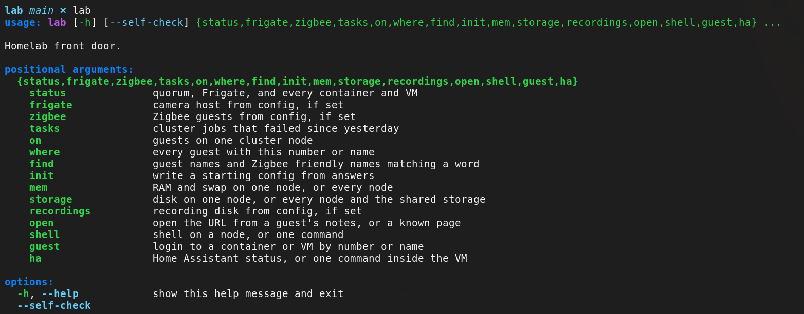

# lab

A typed homelab front door. One command for the morning check, and one command to log into a machine, a container, or a VM.

It is a single Python 3 file. It uses the standard library and OpenSSH. It does not start, stop, or migrate guests.

An agent doing a first install should read [install-prompt.md](install-prompt.md) and do what it says.

```bash
lab status
lab tasks
lab guest ha
lab shell node-b
```



## Install

```bash
git clone https://github.com/dreed47/lab.git ~/code/lab
ln -sfn ~/code/lab/lab ~/.local/bin/lab
mkdir -p ~/.config/lab
cp ~/code/lab/lab.example.toml ~/.config/lab/config.toml
# edit that file: cluster host, nodes, LAN prefix, and any services you have
lab --self-check
```

`~/.config/lab/config.toml` is yours. It is not in the repo. Without it, cluster commands stop and say what is missing. A command whose service is not in the config says `not configured` instead of assuming a guest number.

`~/.local/bin` needs to be on `PATH`. The self-check stays on this computer. It does not SSH anywhere.

## Agent skill

Optional. The program runs without it. The skill tells an agent to run `lab` first, and what not to touch. It does not contain your host names.

Hermes, or any agent that reads the Agent Skills format:

```bash
mkdir -p ~/.hermes/skills
ln -sfn ~/code/lab/skills/lab ~/.hermes/skills/lab
```

If you already keep a private lab skill, leave that one in place. This file is the generic starter, not a replacement for notes about your own machines.

## Starting config

Do not copy `lab.example.toml` and hope. An agent, or you, can build a real file:

```bash
lab init --print --cluster node-a --nodes node-a,node-b --lan 10.0.0.
lab init --write --cluster node-a --nodes node-a,node-b --lan 10.0.0.
```

`--print` previews. `--write` saves `~/.config/lab/config.toml`. It will not replace an existing file unless you pass `--force`.

An agent should follow `skills/lab/init-prompt.md`: ask for the host names and guest numbers, preview, then write. Do not make those names up.

## More than one computer

`lab` can run on more than one computer. Each computer has two parts, and they are updated differently.

The program is the git checkout. Update it with `git pull` in `~/code/lab`. Do not copy the script from another computer. A copied script goes stale. Edit and push from one checkout. The other computers only pull. Pull before you edit, or an old checkout can push over newer work.

The config is `~/.config/lab/config.toml`. It is not in git. It has your host names. After you change it, copy that one file to every computer that runs `lab`:

```bash
scp ~/.config/lab/config.toml other-computer:.config/lab/config.toml
```

If you skip that copy, the other computer still has the old host names.

If you want your agent to keep this in sync, tell it which computers run `lab`. After a script change, it pulls on each one. After a config change, it copies that config file to each one. It does not copy the script. It does not commit the config. It does not start, stop, or migrate guests.


## What the other machine needs

SSH has to reach the cluster with no password prompt. `lab` uses `BatchMode` and gives up if a key is missing.

These `Host` names are examples. Use your own, and put the same names in the config.

```sshconfig
Host node-a
  HostName 10.0.0.2
  User root

Host node-b
  HostName 10.0.0.3
  User root

Host camera
  HostName 10.0.0.16
  User camera
```

Cluster questions go through the host set as `cluster` in the config. That host runs `pvesh`. A camera or other shell host is not a cluster node. `lab shell` can reach it. `lab on` cannot.

A VM login tries the users listed in `[ssh]`. The example uses `root`. Add the accounts your guests actually answer as.

## Commands

| Command | What you get |
|---|---|
| `lab status` | Quorum, each node, Frigate health, and every container and VM |
| `lab status --json` | The same facts as JSON |
| `lab on node-b` | Guests on that one node |
| `lab where adguard` | Every guest with that name or number |
| `lab find garage` | Guest names and Zigbee2MQTT friendly names that contain the word. Does not read the Zigbee key |
| `lab shell node-b` | An SSH session on a machine this PC can reach directly |
| `lab shell node-b uptime` | One command on that machine |
| `lab guest 101` | A login to that container or VM. A name works too |
| `lab guest plex hostname` | One command inside that guest |
| `lab ha` | Home Assistant guest from config, if set |
| `lab ha /bin/sh -c 'hostname'` | One command on the Home Assistant host, through the guest agent |
| `lab frigate` | Camera host from config, if set |
| `lab zigbee` | Zigbee guests from config, if set |
| `lab tasks` | Cluster jobs since yesterday that need a look |
| `lab mem` | RAM and swap on every node |
| `lab mem node-b` | RAM and swap on one node |
| `lab storage` | Local disks, and each shared disk once |
| `lab storage node-b` | That node's disks, plus the shared storage |
| `lab recordings` | Frigate recording disk, and how long the free space lasts |
| `lab open plex` | The URL from that guest's notes, or a known page |
| `lab --self-check` | Local checks. No network |

`lab shell` knows the hosts in `shell_hosts`. Cluster commands know `cluster_nodes` only.

## Shell, guest, and Home Assistant

`lab shell` is for a computer this PC SSHes to directly. That can be a cluster node or any other host in `shell_hosts`.

`lab guest` is for a container or a VM. A container login is `pct enter` on the node that runs it. A VM login is SSH to the VM's own LAN address. The address comes from the guest agent when the agent is running. Otherwise `lab` looks up the VM's MAC in this PC's neighbor table.

Stopped guests are refused. Two guests with the same name are refused. `lab where` prints both so you can pick the number.

`lab ha` with no extra words prints the guest from config. With extra words it runs them inside that guest through `qm guest exec` on the configured node. That path needs a real program path, such as `/bin/sh`. If `[ha]` is missing, the command says it is not configured.

## Opening a page

Put a line in the guest's Proxmox notes:

```text
open: http://10.0.0.5:32400/
```

`lab open plex` and `lab open 100` both read that line. Several `open:` lines are printed and left for you to choose. One line opens in the browser.

`LAB_OPEN=0` prints the URL and does not launch a browser. A pipe does the same.

These names still open when the notes have no `open:` line, if they are listed under `[pages]`. A guest number does not use that list. Add the note, or use the name.

## Morning check

`lab status` is the overview. `lab tasks` is the jobs since yesterday at midnight. Console sessions are skipped. A clean report exits 0. Anything that needs a look exits 1, and a backup warning includes the lines from that job's log.

Backups run at 02:00–02:45. In that window `lab status` and `lab zigbee` say that MQTT and Zigbee2MQTT are stopped on purpose.

`lab mem` prints `tight` when RAM is at 85% or more. It prints `swapping` when swap is at 25% or more and RAM is under that line.

`lab storage` shows shared storage once. A node name still includes that shared copy, plus the node's own disks.

`lab recordings` reads `frigate.recordings` from the config. It uses the date folders under `recordings/` and the free space on that mount. If that section is missing, the command says it is not configured.

## When the cluster changes

A new container or VM shows up in `lab status`, `lab on`, `lab where`, `lab guest`, and `lab open` with no edit. `lab open` needs an `open:` line in the notes before a new name has a page.

These stay in `~/.config/lab/config.toml`, not in the script:

- Cluster node names, extra shell hosts, and which host runs `pvesh`
- LAN prefix used when looking up a VM address
- Home Assistant guest, Zigbee guests, and the camera host
- Backup window, if you have one
- Fallback pages for `lab open`

A new physical node needs an SSH `Host` entry and a name in `cluster_nodes`. A shell-only machine goes in `shell_hosts` only.
